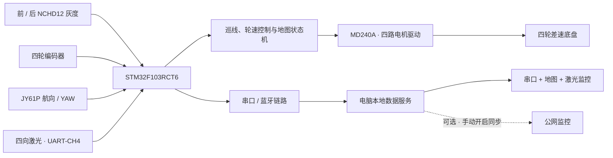

<div align="center">

# Robot Treasure · 密室夺宝机器人

**STM32 四驱差速控制 · 双灰度循迹 · 四向激光感知 · 地图策略 · 实时串口监控**

面向“密室夺宝”场景的嵌入式机器人项目，记录从单电机调试、灰度巡线到取宝、躲藏与逃跑策略的开发过程。


[工程导航](#工程导航) · [硬件配置](#硬件配置) · [快速开始](#快速开始) · [实时监控](#实时监控) · [文档与验证](#文档与验证) · [开源许可](#开源许可)

</div>

> **这是持续迭代的工程与实验归档，不是一份所有版本都已验收的比赛固件。**
> 固件、源码、日志和实车结果需要对应同一版本。部分工程仅编译通过，尚未完成硬件验证；具体结果请阅读各目录的 README、修改规范和验证记录。

## 项目可以做什么

| 模块 | 内容 |
| :--- | :--- |
| 四轮运动控制 | 四个电机独立驱动、独立编码器反馈；轮速 PI、目标速度平滑与差速运动 |
| 前后灰度循迹 | 两块 12 路 NCHD12 提供循迹和路口特征，支持前进与倒车方向切换 |
| 地图与节点 | 使用拓扑节点、路段长度、行驶方向和路口动作组织路线 |
| 对手感知 | UART-CH4 接入前、左、右、后四向测距；各实验版本包含有效性、方向及地图边界过滤 |
| 小偷策略 | 首次取宝、藏点停车、激光触发逃跑、指定走廊与途中遇阻回退等实验 |
| 定位与恢复 | 综合路线历史、灰度、编码器和 YAW；包含找线、回撤及重定位实验 |
| 实时监控 | 同一串口数据流显示文本日志、激光距离、地图路径、YAW及行驶计时 |
| 离线验证 | Python 测试、协议回放、策略仿真及部分实际 ARM 固件仿真测试 |

系统以 STM32 为运动主控，没有把摄像头、YOLO、Jetson 或 ROS 作为当前循迹控制的前提。

## 系统结构



地图位置是传感器与路线状态推定的结果，不是外部定位系统直接测出的绝对坐标。日志显示到达某节点，并不能独立证明实车已经精确居中于该节点。

## 硬件配置

| 部件 | 项目采用的配置 / 作用 |
| :--- | :--- |
| 主控 | STM32F103RCT6；具体目标型号以所选 Keil 工程为准 |
| 底盘 | R5 四驱底盘，四轮差速 |
| 电机 | MC520P30_12V 编码器减速电机 ×4，65mm 轮胎 |
| 电机驱动 | MD240A 四路 TB6612FNG 驱动板 |
| 循迹传感器 | NCHD12 12 路灰度 ×2，经 I²C 读取 |
| 航向传感器 | JY61P，用于转向与航向相关实验 |
| 测距 | AI-1811 系列测距模块，UART-CH4 四串口扩展方案 |
| 通信与调试 | ST-Link、USB 转 TTL、蓝牙串口；电脑串口常用 115200 / 8N1 |
| 电源 | 3S 锂电池与 DC-DC 控制电源，实际接线以硬件文档为准 |

四个车轮分别占用驱动通道。前后灰度板是不同位置、不同安装方向的两组观测，不能直接拼成横向连续的 24 路数据。不同版本的引脚与接口可能变化，上车前请核对对应文档。

## 仓库目录

```text
Robot_Treasure/
├─ STM32/Keil_Project/          # 基础驱动、循迹、测距、地图与策略实验
├─ Docs/                        # 总体设计、硬件说明、阶段记录与问题分析
├─ Tools/                       # 监控后台、地图工具、仿真与回放
├─ Test/                        # 测试与实验材料
├─ 循迹/                        # 循迹相关资料
├─ 硬件资料（部分已有）/          # 传感器手册、示例与结构资料
├─ DesktopSerialMonitor/        # 串口调试与本地监控一体助手
├─ DesktopSerialMonitorTelemetry/ # 遥测显示实验版
├─ DesktopSerialSwitch/         # 桌面手动开关工具
├─ sites/robot-treasure-monitor/ # 公网监控网页与本机桥接源码
└─ 技术文档草稿/                 # 技术报告、图表与文档草稿
```

目录中保留了多个试验阶段及部分参考快照。同名或带“副本”的工程可能有不同控制参数，不能仅按文件夹名字判断哪一个适合直接烧录。

## 工程导航

| 想查看的内容 | 入口 |
| :--- | :--- |
| 所有 Keil 工程 | [STM32/Keil_Project](STM32/Keil_Project/) |
| 四轮与底盘基础 | [Four_Motor_Base](STM32/Keil_Project/Four_Motor_Base/)、[Four_Motor_SpeedPid_Test](STM32/Keil_Project/Four_Motor_SpeedPid_Test/) |
| 灰度基础读取 | [Gray12_I2C_BasicRead_Test](STM32/Keil_Project/Gray12_I2C_BasicRead_Test/) |
| 前后灰度与转弯循迹 | [Gray12_SideTurn_LineFollow_Test](STM32/Keil_Project/Gray12_SideTurn_LineFollow_Test/) |
| 倒车与原路返回 | [Gray12_DesktopBase_ReverseReturn_Test](STM32/Keil_Project/Gray12_DesktopBase_ReverseReturn_Test/) |
| 四路激光距离校准 | [Laser_UARTCh4_RangeCalibration_Test](STM32/Keil_Project/Laser_UARTCh4_RangeCalibration_Test/) |
| 小偷地图策略 | [Thief16V_UARTCh4_RouteOnly_Test](STM32/Keil_Project/Thief16V_UARTCh4_RouteOnly_Test/) |
| N038 藏点实验 | [N038 主工程](STM32/Keil_Project/N038_Thief16V_UARTCh4_RouteOnly_Test/)、[副本 (2)](<STM32/Keil_Project/N038_Thief16V_UARTCh4_RouteOnly_Test - 副本 (2)/>) |
| 运行中遥测 | [Thief16U_UARTCh4_LiveMonitor_Test](STM32/Keil_Project/Thief16U_UARTCh4_LiveMonitor_Test/) |
| 地图、协议与监控后台 | [Tools/MapTimingLogger](Tools/MapTimingLogger/) |
| 策略模拟与回放 | [Tools/TreasurePursuitSimulator](Tools/TreasurePursuitSimulator/) |

### 关于策略与控制参数

- 取宝、藏点、逃跑路线属于策略层；轮速、巡线、入点和转向接线属于控制层。
- 传感器“有距离数据”与“该数据参与避障”是两件事，需要结合通道状态和当前车辆姿态判断。
- 灰度快速检测、PID控制、激光输出和串口上传使用不同周期，不能用网页刷新速度代替实车采样频率。
- 距离阈值、激光屏蔽、藏点方向和转弯参数按工程分别设置，没有一个适用于全部历史版本的全局值。
- 修改前先阅读对应工程的 README、AGENTS.md 和《修改规范与回归清单》。

## 快速开始

### 1. 获取仓库

```bash
git clone https://github.com/aaayolo-ui/Robot_Treasure.git
cd Robot_Treasure
```

### 2. 编译固件

1. 从工程导航选择一份实验，先读该目录的说明和验证记录。
2. 在 MDK-ARM 目录打开对应的 .uvprojx。
3. 安装工程要求的 STM32 器件包与编译器。部分历史工程使用 **ARM Compiler 5**，不能直接假定 ARM Compiler 6 可替代。
4. 确认目标芯片、源码引用和输出路径，执行 Rebuild。
5. 按该版本的接线、起点与方向完成实物检查后，再由操作者自行烧录。

AXF、HEX、Objects 等生成文件通常由 .gitignore 排除。克隆后应从对应源码重新编译，不能拿其他工程的旧 HEX 代替。

### 3. 打开本地监控

[一体助手使用说明](DesktopSerialMonitor/README.md) · [原始监控工具](Tools/MapTimingLogger/)

1. Windows 环境先核对 Python、pyserial 与 Edge WebView2 运行时。
2. 使用对应目录的 build.ps1 构建桌面工具；脚本中的 Python、编译器路径可能需要按本机调整。
3. 启动助手，点“开启后台”；此时不会自动连接串口。
4. 选择实际 COM 口，设置波特率，手动连接。
5. 在“实时监控 + 串口”查看日志、四路激光和地图；需要使用其他串口助手时先断开连接。

```powershell
cd DesktopSerialMonitor
.\build.ps1
```

桌面工具是带环境依赖的 Windows 程序，不宣称复制一个 EXE 到任意电脑就能运行。

## 实时监控

| 界面 | 可以观察什么 |
| :--- | :--- |
| 串口数据 | 文本 / HEX、时间戳、接收计数、暂停显示与日志保存 |
| 地图路径 | 节点编号、已行驶轨迹、缩放和平移、定位待确认提示 |
| 四向激光 | 前后左右距离、有效性与状态；以实际固件输出为准 |
| 车体状态 | 前后灰度、YAW、航向误差和停车原因 |
| 行驶计时 | 根据支持的主控 START / END 记录开始和结束，不把连接串口时间当出发时间 |

[公网监控源码与桥接说明](sites/robot-treasure-monitor/README.md) 支持电脑串口数据的远程展示。公网网页、电脑桥接、串口连接和车辆传感器是不同环节：网页能打开不代表电脑在线，COM已连接也不代表有有效传感器数据。公网部署需要自行配置服务与凭据；仓库不保证历史部署网址永久可用。

## 文档与验证

| 文档 | 用途 |
| :--- | :--- |
| [总体方案设计](Docs/03_总体方案设计.md) | 硬件与系统分工 |
| [硬件清单](Docs/04_硬件清单.md) | 部件与配置依据 |
| [STM32软件架构设计](Docs/05_STM32软件架构设计.md) | 模块划分 |
| [开发记录](Docs/06_开发记录.md) | 迭代历史 |
| [技术成果索引与验证边界](Docs/19_技术成果索引与验证边界.md) | 技术材料导航 |
| [项目共享与归档说明](Docs/24_项目共享与归档说明.md) | 共享工程与历史归档 |
| [原README历史基线说明](Docs/README_历史基线说明_20261102.md) | 保留旧阶段描述，避免混淆当前状态 |
| [技术文档草稿](技术文档草稿/) | 更完整的算法、控制与实验说明 |

**请区分三类证据：**

| 验证层级 | 能证明 | 不能直接证明 |
| :--- | :--- | :--- |
| 编译通过 | 指定源码在指定工具链可生成固件 | 接线正确、传感器有效或整车能稳定运行 |
| 离线 / ARM仿真通过 | 给定输入下的算法、状态机与协议行为 | 真实轮胎打滑、灰度漏读、电源压降与机械偏差 |
| 实车验证 | 对应硬件、固件、地图与工况下的表现 | 所有历史版本和其他硬件同样有效 |

本次仓库整理仅更新文件归档与说明，没有重新编译全部工程，也没有执行新的实车测试。各 Tests、VALIDATION、build 日志及阶段文档保留其原有验证范围。

## 参与改进

提交问题时，请附上工程完整名称、启动日志中的 FW 标识、问题前后的串口原文，以及实车位置、朝向与传感器观察。路线显示和实车不一致时，请同时说明两者，避免把软件推定坐标当作独立定位证据。

改动尽量集中在单个实验工程，保留已验证基线；控制参数、策略和界面分别说明。不要在提交中加入访问令牌、电脑本地凭据、node_modules 或测试依赖缓存。

## 开源许可

本项目中由维护者编写并有权授权的原创代码，以 [MIT License](LICENSE) 开源，允许使用、修改、分发与商用，具体条件见许可证。

**第三方代码与资料不自动适用本项目MIT许可。** STM32 HAL / CMSIS、SDK、依赖库及商家示例保留原版权和许可证；硬件手册、CAD与其他资料的使用和再分发权限以各自权利人声明为准。本仓库不是厂商官方发布。

---

<div align="center">

从一条黑线开始，把每一次误认、回撤与恢复，变成可复核的工程记录。

</div>
